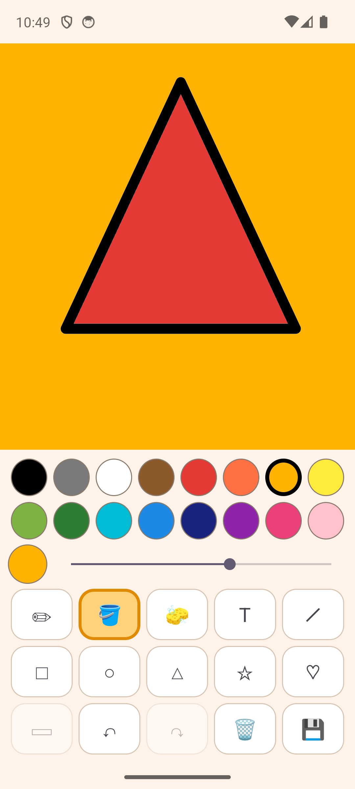

# Paint

A drawing app for a small child, built for a phone.

<p align="center"></p>

## What it does

- **Draw** — freehand brush with a size slider, and an eraser.
- **Shapes** — line, rectangle, oval, triangle, star, heart. Drag to size them;
  the ▭/▬ button switches between outline and filled.
- **Fill** — a paint bucket that floods any enclosed area, including areas
  enclosed by a wobbly freehand line.
- **Text** — tap the paper, type a word, and it lands where you tapped in the
  current colour and size.
- 16 colours, unlimited undo/redo, and a save button that puts a PNG in
  `Pictures/Paint` in the phone's gallery.

The picture is kept between sessions automatically, so closing the app does not
lose the drawing.

## Building

```
./gradlew assembleDebug
```

Needs JDK 17+ and an Android SDK with platform 35. The resulting APK is at
`app/build/outputs/apk/debug/app-debug.apk`; `./gradlew installDebug` builds and
installs it on an attached device.

Minimum Android version is 7.0 (API 24).
