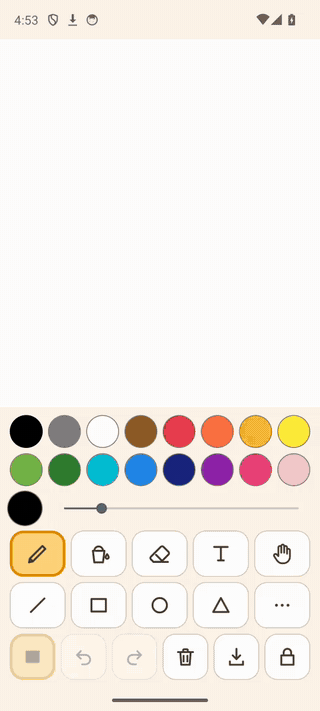

# Little Painter

A drawing app for small children (about 3–6) on an Android phone: big buttons,
no menus, no ads, no internet.

<p align="center"></p>

- **Everything on one screen.** Colours, tools, undo and save are all visible at
  once, the extra shapes one tap away behind "...". Nothing to scroll, no menus
  a child would have to discover.
- **Shapes a small finger can place.** A shape stays movable after it is drawn,
  with big knobs to move, size, turn or bin it, so the fingertip never covers the
  thing it is holding.
- **A kid mode for handing the phone over.** Screen pinning, a usage timer shown
  as a bar, and a sum-and-PIN unlock. Not escape-proof — [what it can and cannot
  do](#what-screen-pinning-can-and-cannot-do).

[Install](#install) · [Build from source](#building) ·
[How it compares](#how-it-compares) · [Privacy](#privacy) ·
[Security](SECURITY.md) · [Licence](#licence) · Android 7.0+ phones only;
no iOS, no tablet layout.

**Why not Tux Paint?** Tux Paint is the mature, far bigger open-source painting
program for children and runs everywhere; Little Painter is smaller and made
only for a phone held in one hand, with a parent's kid mode built in. More in
[How it compares](#how-it-compares).

## Install

**APK:** download `little-painter-<version>.apk` from the
[latest GitHub release](https://github.com/JohannesHoh/child-paint/releases/latest)
and open it on the phone. Android asks once to allow installs from your browser
or file manager. Updates are the same: install the newer APK over the old one;
the drawing and settings stay.

Not on Google Play or F-Droid yet. To build it yourself, see
[Building](#building).

## What it does

- **Draw** — freehand brush with a size slider, and an eraser.
- **Shapes** — line, rectangle, oval and triangle on the toolbar; star, heart,
  diamond, pentagon, hexagon, arrow, cloud, moon, sun, lightning, flower and
  speech bubble behind the "..." button. Drag to size them, or tap to stamp one
  3 cm across.
  A shape stays adjustable after the finger lifts: a dashed box marks it, one
  finger drags it somewhere else, two fingers pinch to resize and twist to turn
  it, and four knobs on strings do the same for a finger too big to aim with.
  Touching anywhere else settles it. A brush stroke lands where you dragged, but
  a moustache lands in the right place only by luck.
  The style button cycles **filled → filled with a rim → outline**; filled is the
  default, because an outline a child then has to aim the paint bucket into is a
  second step they did not ask for. The rim colour is derived from the fill (45%
  towards black, or towards white when the fill is dark), so every colour gets a
  visible edge without a second colour to choose.
- **Fill** — a paint bucket that floods any enclosed area, including areas
  enclosed by a wobbly freehand line.
- **Text** — drag a box and type into it.
- **The hand** — picks up anything already on the paper and moves it again, or
  lifts a rectangle of pixels when dragged on empty paper.
- 16 colours, unlimited undo/redo, and **My pictures**: the save button keeps
  the drawing as an editable picture and puts a PNG in `Pictures/Little Painter`
  in the phone's gallery.

Three more things are off until a grown-up switches them on — see
[Grown-up extras](#grown-up-extras).

The picture is kept between sessions automatically, so closing the app does not
lose the drawing.

## Grown-up extras

All three are off by default. Press and hold the padlock **in parent mode** to reach
the panel that turns them on; in kid mode the same hold is the unlock, so a child
cannot get at either of them.

- **Paint on a photo.** Pick a picture from the phone and it becomes the page,
  letterboxed to fit and ready to be drawn on. It replaces whatever was on the
  paper — a new page starts a new history, so undo does not bring the old drawing
  back, which is why this one asks first. The picker is the system photo picker:
  it needs no gallery permission, and it is hidden in kid mode, so the photo is
  chosen before the phone is handed over. The same button is the way back out:
  it offers **Pick a photo** and **Plain paper**, and plain paper throws the photo
  away for good. Holding the clear button only paints over a photo — it stays
  underneath, and undo walks back onto it.
- **Dress-up shapes.** Four more shapes in the "..." drawer — glasses,
  moustache, umbrella, crown — dragged to size like every other shape,
  and outline or filled like every other shape (filled glasses are sunglasses).
  They exist for drawing on a photo of a face; on a blank page they are clutter,
  which is why they are opt-in.
- **Hide the tools.** The toolbar disappears entirely and the paper fills the
  screen. A small handle at the bottom edge brings the tools back, and they stay
  up until the paper is touched again. The toolbar floats *over* the paper rather
  than sharing the screen with it: a toolbar that took up layout space would
  resize the canvas every time it opened, and the bitmap is recreated on a size
  change.

## Parent mode and kid mode

The app starts in **parent mode** — the full toolbar above, plus a padlock button
that hands the phone over to the child.

**Kid mode** is for leaving a child alone with the phone:

- **One canvas, no saving.** The save button is hidden and nothing is written to the
  phone's gallery. There is one drawing, and it is kept automatically.
- **Hard to leave.** The app is pinned to the screen, system bars are hidden,
  and Back and Home do nothing. It is not escape-proof — see
  [what screen pinning can and cannot do](#what-screen-pinning-can-and-cannot-do)
  below.
- **A usage timer.** The parent picks 5 minutes to 2 hours, a custom number of
  minutes, or no limit. Time left shows as a bar rather than a clock, since the
  child this is for cannot read one; it turns orange under 5 minutes and red
  under 1. When it runs out, a full-screen overlay blocks the paper and the
  tools until a grown-up unlocks it — the drawing is kept, not thrown away.
- **A guarded way back, at any time.** Press and hold the padlock in the toolbar —
  it is there for the whole session, not only once the time runs out. Unlocking
  asks a sum (two two-digit numbers that need no carrying, like 32 + 24) and then
  a 4-digit PIN. Either barrier can be switched off when kid mode is started.
- **A buzz or an alarm when time runs out.** Both optional, both set when kid
  mode starts; the buzz is on by default and the alarm is not. The alarm plays on
  the alarm stream, so it carries to the next room even with the ringer down, and
  it stops itself after 8 seconds or the moment a grown-up unlocks — an alarm
  nobody silences is a punishment for the child sitting next to it.
- **Three tries, then a five-minute wait.** Three wrong answers and the unlock
  refuses to open again for five minutes, so the PIN cannot be guessed by
  hammering at it. Only the *last* barrier counts towards that: when a PIN is
  set, wrong answers to the sum are free, so a child poking at the question
  cannot lock a grown-up out of their own phone. With the PIN switched off the
  sum is the last barrier, and wrong sums do count.

The session is stored on disk, not in memory: force-stopping the app or rebooting
the phone comes straight back to kid mode with the same time already used up, and
with any wait from too many wrong PINs still running.

### What screen pinning can and cannot do

Pinning is Android's own feature and the app is not a device owner, so:

- The **first** time kid mode starts, Android asks the parent to confirm pinning.
  On some phones screen pinning must first be enabled under
  *Settings → Security → Screen pinning*.
- A child who knows to **swipe up and hold** can unpin. Android can require the
  lock-screen PIN for that ("Ask for PIN before unpinning" in the same settings
  screen) — turn it on if that matters to you.

Even then, escaping the pin only reaches the home screen: reopening the app lands
back in kid mode, with the timer still counting down from before.

## Building

```
./gradlew assembleDebug
```

Needs JDK 17+ and an Android SDK with platform 36. The resulting APK is at
`app/build/outputs/apk/debug/app-debug.apk`; `./gradlew installDebug` builds and
installs it on an attached device.

Minimum Android version is 7.0 (API 24).

A release build additionally needs signing material, which is not in the
repository: copy `keystore.properties.example` to `keystore.properties` and fill
it in. Without that file the release build is deliberately left unsigned rather
than falling back to the debug key, so the build cannot quietly produce
something that looks shippable and that Google Play would reject. The full
publishing sequence is in [docs/release-checklist.md](docs/release-checklist.md).

Unit tests: `./gradlew testDebugUnitTest`.

## How it compares

Little Painter is one small app among several; pick by what you need. "Not
listed" means the app's F-Droid page does not mention it, not that it is
missing. Checked October 2026.

| | Little Painter | [Tux Paint](https://f-droid.org/en/packages/org.tuxpaint/) | [BabbyPaint](https://f-droid.org/en/packages/dev.alexjyong.babbypaint/) | [Little Painter (marietetbc)](https://f-droid.org/en/packages/io.github.marietetbc.littlepainter/) |
|---|---|---|---|---|
| Made for | a phone, one hand | desktop first; Android, Windows, macOS, Linux | a phone | a phone |
| Tools | brush, 16 shapes, bucket, text, move | far more: stamps, magic effects, sounds, starters | brush, eraser, undo/redo | brush, eraser, 4 stamps |
| Adjust a shape after drawing | yes, knobs and pinch | not listed | not listed | not listed |
| Parent lock | screen pinning + sum and PIN | config options (e.g. hide quit) | lock button | screen pinning + PIN |
| Timer | yes, blocks the paper at the end | not listed | not listed | gentle hourglass reminder |
| On F-Droid | not yet | yes | yes | yes |
| Licence | Apache-2.0 | GPL-2.0+ | GPL-3.0 | GPL-3.0 |

Where the others win: **Tux Paint** is mature, far richer and runs on every
platform; **BabbyPaint** is simpler; the **other Little Painter** (an unrelated
app that happens to share the name) is on F-Droid today and needs nothing but
a finger. If all you want is a time limit and a lock around *any* app,
Android's own **Digital Wellbeing** app timers or **Family Link** do that
without installing anything.

## Contributing

Bug reports, translations and small fixes are welcome; new tools start as an
issue. See [CONTRIBUTING.md](CONTRIBUTING.md), and read [CLAUDE.md](CLAUDE.md)
before changing code — its "Things that will bite you" section is the short
list of decisions that look wrong until you know why they are there.

## Privacy

The app requests no internet permission. Nothing is collected and nothing leaves
the phone. See [docs/privacy-policy.md](docs/privacy-policy.md).

## How it was made

Written with Claude Code by one person, mostly from a phone. The gif at the top
is redrawn by `scripts/demo/record-gif.sh` on an emulator.

## Licence

Apache-2.0. See [LICENSE](LICENSE).
